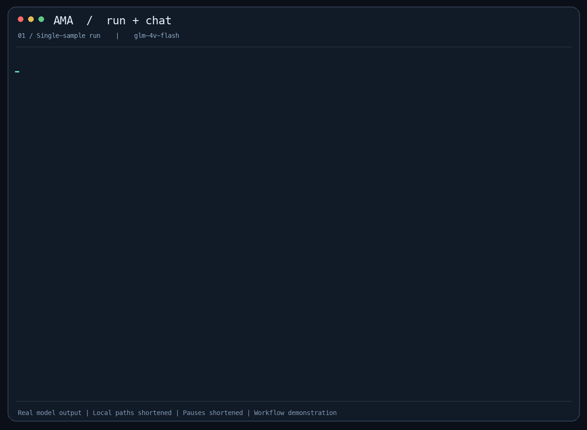

# AMA — 一个最小化的临床Agent

中文 | [English](README.md)

[](https://github.com/Algnite-Solutions/aignite-medical-harness/actions/workflows/ci.yml)

Agent 只做三件事：保存历史、请求模型、执行可选工具。它不认识 Episode，也不负责评分。
实验层才决定“什么时候把数据集的下一条 observation 给它”。



[视频 MP4](assets/ama-demo.mp4) · [终端记录 .cast](assets/ama-demo.cast)

使用 `glm-vision` 和公开 ROCOv2 样本真实录制：单样本运行、查看保存的结果，再追问
“你把你的预测用中文说一遍”“这个一般是什么病症”，最后演示 `/next` 与 `/quit`。
保留模型原文，包括缺失 caption 和错误的医学推断；演示用于说明操作流程。
GIF/视频缩短了等待时间，录制中的本地路径改为相对路径。
可用 `asciinema play assets/ama-demo.cast` 回放终端记录。

## 安装

```bash
python3 -m pip install -e ".[dev]"
python3 -m pytest -q
# 参照 .env.example，把密钥写入本地 .env。
ama run datasets/rocov2_demo --model qwen36
ama eval runs/<运行目录>
ama chat datasets/rocov2_demo --episode ROCOv2_2023_test_000001 --model qwen36
```

GitHub Actions 在发往 `main` 的 PR 和 `main` 更新时，使用 Python 3.11 运行确定性测试与 CLI 安装检查。
CI 无需模型 API 密钥。

模型在 `ama.json` 注册；测试假模型只放在 tests，不是运行选项。
注册成功不代表服务一定支持图像或工具，二者混用还需小样本检查。

本次小样本兼容性检查：GLM 返回合法 Decision，但缺少 caption（按空预测评分）；
Qwen 纯文本工具及追问通过，但本次图像输出未满足 Decision 格式，工具返回图像被接口拒绝。
`--model glm-vision` 已跑通运行与评测流程，不代表任务答案完整。这不是模型能力排名。

- `run`：自动依次释放 observation，每个样本用一个新 Agent，每轮返回 JSON Decision。
- `chat`：自动释放第一轮；普通输入是追问，`/next` 才推进一轮，`/quit` 保存退出。
- 最后一轮之后仍可追问；chat 可自然语言回答，是探索记录，**不能评测**。

两者自动检查可见数据，默认使用数据集的 `instructions.txt`。
`--instruction-file 文件` 替换任务说明；`--tools examples/tools.py` 显式启用工具。
默认没有工具，没有摘要或历史裁剪，没有自动重试或 JSON 纠错对话。
`--max-calls 8` 是每条输入的模型调用上限；`--timeout 60` 是单次请求超时秒数。

医学工具通过 `--tools src/ama/medical_tools.py` 启用，注册五个函数：

- `pubmed_search(query, retmax=5, abstract=True)`：检索 PubMed，返回 PMID、标题、期刊、年份、摘要，以及来源提供的 PMCID、DOI 和全文链接；摘要读取失败时退回无摘要的元数据。
- `guideline_search(query, max_results=5, live=True, population="", subtype="", intent="", year_to=None, search_expression="")`：合并五条经来源核对的本地索引与 Europe PMC 候选，按主题、文档类型和适用范围过滤排序；支持人群、疾病亚型、诊疗意图和年份上限。`max_results` 限制合并去重后的总数；`live=False` 完全离线。机构与期刊分开，摘要截断会标明，最新版本状态不作保证。
- `paper_fulltext(pmcid="", section="", max_chars=20000, pmid="")`：在线读取 Europe PMC 可获取的论文全文 XML，按章节返回。PMCID 和 PMID 二选一；后者先精确解析 PMCID。支持嵌套章节 ID、标题及 diagnosis/investigation/treatment 意图匹配，返回章节来源链接；`max_chars` 限制总正文长度并注明截断。
- `clinical_trial_search(condition, intervention="", status="", max_results=5)`：在线检索 ClinicalTrials.gov，返回 NCT 编号、标题、状态、阶段、更新时间、干预、摘要、入排标准和最多五个地点。状态可填 `RECRUITING`、`COMPLETED` 等，留空不过滤；摘要/入排标准限制为 1000/3000 字符并标明截断。
- `analyze_images(query, image_ids)`：默认调用独立的 DeepSeek Flash 视觉专家读取当前轮次已释放的 PNG/JPG 图片，仅将文字分析返回主 Agent。支持多图比较；必要的临床背景需放入 query。

新增的全文与试验检索使用免费公开接口，无需工具 API key，仍需遵守服务端请求限速。
完整参数、检索限制及测试方式见 [医学检索工具说明](docs/medical-search-tools.md)。
全文接口仅能读取其可提供的文章；试验匹配结果不代表个人已经满足入组条件。

```bash
ama chat datasets/rocov2_demo --episode ROCOv2_2023_test_000001 --model qwen36 --tools src/ama/medical_tools.py
```

成功搜索返回列表，全文读取返回对象，失败返回 `{"error": ...}`；指南检索部分失败时还会通过 `results` 保留可用结果。
检索工具仅使用标准库，单次联网超时 20 秒、下载上限 4 MiB，不注册病例 evidence ID。
可在环境变量或 `.env` 配置 `NCBI_EMAIL`、`NCBI_API_KEY`；NCBI 限流在当前进程内生效，多进程需另行协调。
`AMA_GUIDELINES_PATH` 可指定自定义 UTF-8 JSON 索引：对象列表，每项必须有 `title` 和 `url`，
可附 `org`、`year`、`keywords`、`key_points`、`abstract` 和 `pub_type`。
内置索引仅提供 KDIGO 2024 CKD 作为起点，完整性依赖联网查询或自行维护索引。
与 MIMIC 病例工具一起加载的方法见 [英文说明](README.md#optional-tools)。

只启用视觉分析工具，可以运行：

```powershell
python -X utf8 -m ama.cli chat datasets/rocov2_demo --episode ROCOv2_2023_test_000001 --model deepseek-flash --tools src/ama/image_analysis_tools.py
```

例如输入：`请调用 analyze_images，分析 image-ROCOv2_2023_test_000001，说明可见结构和不确定之处。`
启用视觉分析工具后，主 Agent 只接收图片 ID 目录；每轮实际释放的图片绑定到工具，未来轮次和其他病例的图片不可请求。
专家每次只收到本次 query 和所选图片，主 history 不附加原图、叠加图或专家的独立历史。
成功分析后，相应图片 ID 才通过工具结果释放为可引用证据。未启用图片委托工具时，原有直接传图行为保持不变。
`episode_start` 日志记录 `image_delivery`（`tool_only` / `direct`）。

默认使用 `ama.json` 中的 `deepseek-flash` 与现有 `DEEPSEEK_API_KEY`。
可通过 `AMA_VISION_MODEL` 和 `AMA_VISION_CONFIG` 改选专家模型别名及配置路径。
每病例最多四次专家 API 请求；同 query、同图片 ID 顺序和内容哈希的请求命中本病例缓存。
每次最多 49 张 PNG/JPG、原始文件合计 24 MiB；专家超时 60 秒、输出预算 2048 tokens，返回分析最多 6000 字符并标记截断。
工具结果记录图片路径/哈希、模型配置、用量和耗时；专家用量单列在工具结果中，尚不计入主模型用量汇总。
视觉专家请求会按所配置模型账号计费，与免费公开检索接口不同。
真实双图调用测试：`RUN_API_TESTS=1 python -m pytest -q tests/test_image_analysis_tools_api.py`（PowerShell 中先设置对应环境变量）。

真实 API 工具调用测试（PowerShell；从本地 `.env` 读取 `DEEPSEEK_API_KEY`）：

```powershell
$env:RUN_API_TESTS = "1"
python -X utf8 -m pytest -q tests/test_medical_tools_api.py
Remove-Item Env:RUN_API_TESTS
```

四个模型用例分别检查 DeepSeek 调用 PubMed、在线指南、论文全文与临床试验检索，并使用工具返回值回答。
默认测试会跳过它们；显式启用会消耗模型 API 额度，在线工具还需访问对应数据源。
仅验证免费检索接口时，设置 `RUN_MEDICAL_TOOLS_LIVE_TESTS=1` 并运行同一测试文件的 `-k 'not deepseek'` 用例；共 12 项，不调用模型。

## 阅读顺序

按“模型请求 → 多轮历史 → 工具循环 → 数据与 CLI”阅读
[最小 Agent 导读](docs/minimal-agent.zh-CN.md)，里面有可直接执行的例子与对应测试。

| 位置 | 唯一职责 |
|---|---|
| `model.py` | 配置别名、发送前编码图像、发一次请求 |
| `agent.py` | 同一个 history 上追加消息，循环至最终回复 |
| `tools.py` | 显式工具定义、Python 函数绑定、返回值 |
| `runner.py` | 释放材料、检查 Decision、run/chat 流程 |
| `cli.py` | 命令入口与独立 eval |
| `data.py` / `scorer.py` | 数据对象与检查 / 评分定义 |
| `recorder.py` | 原始消息、决策和实验配置记录 |

工具文件是可信 Python，不是沙箱。不要让工具读取参考答案或未来轮次。
没有历史协议层、暂停菜单或图像/工具角色改写；服务不支持时明确报错。

## 数据和记录

以ROCOv2为例。每张图像是一例、一轮；也只能多轮对话数据。

```bash
ama import rocov2 --source /path/to/ROCOv2 --out datasets/rocov2 --split test --limit 100
ama run datasets/rocov2 --model qwen36 --split test
```

也可用可重复的 `--episode ID` 替代 `--split`，`--runs-root 目录` 指定输出父目录。

新增的文本数据集见 [Symptom2Disease demo 数据卡](datasets/symptom2disease_demo/DATASET_CARD.zh-CN.md)，
其中包含导入、校验和运行方法。

运行目录保存实际提示、模型配置、数据哈希、预期轮次、逐条消息来源、原始回复、
工具调用 ID/结果和终止原因。图像只记录路径，不把 base64 写进日志。
普通追问和数据集材料在日志里分别为 human / dataset，发给模型时都是 user。

`chat` chat模式下没有关于decision格式的prompt指引，作为交互和数据集观察用。

`run` 的 JSON 无效时保留原文、记失败，不追加纠错对话。
API 错误或调用上限终止当前样本，继续下一例；Ctrl-C 保存后停止整个批次。
失败和缺失回答不会从评分分母中消失。部分失败时 CLI 返回非零状态，仍可独立 eval。

`eval` 才读取参考答案和评分配置，只生成 `metrics.json`；
评测前检查可见数据是否已改变。历史实验记录保留，但需要重新运行才能交给新评测器。
详见 [字段说明](docs/ama-dataset.zh-CN.md)。

模型原文保留在 `decisions.jsonl`，参考原文在数据集的 `targets.jsonl`，按样本和轮次 ID 对照。
词重合与 CUI 重合不是临床正确率。
