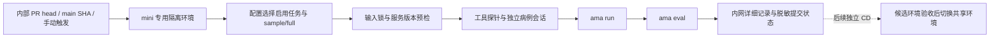

# 统一评测环境：阶段一交付与实施顺序

审计日期：2026-10-23。代码基线：main `98e3fff3fe088e3230654585a572779589f9bacf`。
本交付是部署前准备，不是模型实验或真实服务验收；没有运行 ama run / ama eval。

## 运行范围与配置

`benchmarks/regression.example.json` 显式启用 MIMIC-CDM interactive、MIMIC-CXR、PathVQA，禁用 ROCOv2 和 Symptom2Disease。JSON 用于避免仅为配置引入 YAML 依赖。
注册任务和启用列表分离；未来新增注册不得自动启用。sample/full 分别绑定数据路径和锁，null 表示尚未准备；不能回退到 demo 或另一个 suite。

准备审计（可以读取 targets）使用：

```sh
PYTHONPATH=src:. python3 -m scripts.audit_regression_data --config /path/to/private-site.json
```

scope 字段：`dataset`、`lock`；CXR sample 另需 `manifest`。配置副本放在内网，不提交实际路径或凭证。脚本只读数据，不生成锁、不抽样、不调用服务。输出仅聚合计数及固定错误类别，退出 2 表示配置或准备未完成。
它不是未来的 `ama regression check`：后者不得读取 targets 内容。

## 已有 PR 与接入矩阵

| 组件 | 已确认能力 | 下一步 / 缺口 |
|---|---|---|
| MIMIC-CDM（#13 已合并） | importer、病例工具；mimic_cdm 和 mimic_cdm_open scorer；已有三视图 open100 协议 | 只启用 open interactive；定位原四组各25例 cohort 与 benchmark.json，核验引用和病例工具文件，不能用源 interactive 数据代替 |
| MIMIC-CXR（#12 已合并） | findings100-v1 公共锁、私有 transfer manifest、原生 scorer、完整性验证器 | sample 可直接验证；findings-test-v1 已发现但 full 评测范围与锁尚未核验 |
| PathVQA（#19 已合并） | pr100 锁、输入/评分身份分离、49 binary/51 open、pathvqa_v1 scorer | 复用 prepare 做离线身份审计；full 在 test / automedbench_test_500 之间需依据任务协议明确登记，不能猜测 |
| MedAgentBench（#14 open） | PR 声明 importer、tools、scorer | 重试已确认 importer、scoring 与脚本测试及 cli/scorer 修改；合并后需审查字段契约，保留读操作、模拟提交及评分工具历史 |
| 检索与视觉（#16 open） | 既有 PR 检查确认 Tool.on_images 扩展、检索和视觉工具 | 合并后统一错误对象/partial 映射；覆盖全文、试验搜索、视觉和检索探针 |
| ICC（#17 open） | 文件清单确认 srrsh_icc importer、合成/真实数据测试 | 合并后核验材料可见性，保留 unscored；尚未启用 |
| VQA-RAD（#18 open） | 文件清单确认 importer、scoring、cohort export/verify | 合并后覆盖 open、yes/no，明确锁与依赖；尚未启用 |
| ROCOv2 / Symptom2Disease | 已合并 importer、scorer、demo；后者另有固定100协议 | 当前禁用，不要求数据，不计为通过 |

本轮公开 API 已重新确认 #14/#16/#17/#18 未合并。合并前需再核对 main。

## 实际数据准备状态

本机 NAS 共享已挂载并可读，存在三个启用任务的源目录。脚本的实际聚合输出见 `preparation-audit.json`；只有 verified 才表示相应准备验证完成，acceptance 始终为 not_run。

- CXR 使用已有仓库 snapshot 锁及私有 transfer manifest 验证全部文件，不重新解析或导入参考答案。
- PathVQA 使用已有 pr100 的输入与评分身份一起核验，不运行其模型 runner。
- MIMIC-CDM 仅发现源 interactive 和 full-info 目录，原 open100 cohort 尚未定位，保持 blocked；不抽取替代病例。
- 三任务 full 均未完成锁定。即使磁盘上存在目录，也不能算全集准备成功。
- 挂载存在只证明当前审计机器可读；mini runner 账户的挂载权限、Spark 侧对应路径仍需单独核验。

## 部署架构决策（部署前提待核验）

确定分工：mini 运行指定 SHA 的 harness，Spark 提供模型与病例工具服务。模型服务独立管理，工具不允许读取未来 turn 图像。

阶段二默认采用版本化 wheel + 独立 venv + systemd 模板单元。wheel 在 Spark 兼容的 Linux/ARM64 构建环境构建，归档到内网版本目录，经 SSH/SFTP 推送 SHA 命名发布目录；禁止从 Mac 复制 venv。以 git SHA、wheel SHA256、依赖锁摘要标识发布物。Python 版本至少3.11；依赖须在 Spark 架构实测。

容器方案作为后续 CD 扩展：优势是依赖封装，代价是镜像构建、registry 和 GPU/架构兼容管理；当前仓库没有 Docker/compose 或既有镜像发布链，因此先选 wheel，实际端口、SSH 目标、服务账户和目录待部署方确认。

候选版本用独立端口/环境标识启动；`GET /v1/info` 核验协议/代码/环境/工具 schema，健康检查成功才供手动测试。共享环境版本通过受控发布记录指向，回退为重新启动上一发布版本；阶段一不执行推送、重启或切换。

远端契约由阶段二交付：info、sessions、evidence、calls、delete；token 仅环境变量；连接/请求超时分开；状态性调用不自动重试；调用ID、病例隔离、受限图像内容传输、TTL和清理是必须项。

用户提供连接信息后已完成 Spark 只读核验，详见 `spark-runtime-audit.zh-CN.md`。模型服务已有 Docker 部署；工具服务的 wheel/venv 方案仍为待确认默认，不能写成已部署。

## CI/CD 决策与流程



当前只有 ubuntu 无密钥 CI，默认 PR checkout merge commit，且 cancel-in-progress=true；未来 mini 使用独立 workflow，显式 checkout PR head SHA、记录 base SHA，独立串行排队，不继承此取消策略。main 测实际提交。

runner 清单 API 本轮返回 HTTP401，不能确认 runner 已注册或有权限。上线前落实 runner group/工作流访问限制、每任务隔离与清理、只读数据挂载、服务专用 token 和最小网络访问。外部 fork 不运行内网任务；不使用 pull_request_target 执行代码。

自动触发只运行配置启用的 sample；manual 支持 sample/full、单任务/全部启用任务。每次独立输出，sample/full 比较指纹分离。Github 摘要只允许任务状态、计数、错误类别；原始异常、路径和病例日志留在内网30天。取消/缺失/未就绪不能绿灯。

时间、调用和费用预算在单病例与固定100试运行后按实测设置；不在无容量数据时承诺60分钟完成。配置/前置缺失退出2，验收失败退出1，全部通过退出0。

## 后续步骤与门槛

1. **阶段一收口**：定位 MIMIC-CDM open100；明确 full 数据范围及锁；获取 cohort 目录读取权限及 mini runner 清单权限。更新数据就绪清单，核实部署默认适配性。
2. **阶段二**：实现注册与站点配置校验、ama regression list/check、版本化API/客户端；部署方提供候选服务。先合成数据和单病例接通，失败状态、图像可见性和隔离测试通过。
3. **阶段三**：编排标准 run→eval，三个任务各100；提供full。验证超时取消、错误不能被最终回答掩盖、重跑独立记录和指纹比较。完成真实服务及全集验收后记录预算。
4. **阶段四**：新增 mini workflow，验证内部PR/main自动触发及正确SHA关联；脱敏报告、内网保留与串行执行生效后启用自动回归。
5. **阶段五（独立PR）**：实现候选发布、验收后切换与回退；不把未完成真实验收当作发布依据。

阶段二至五均未实施，不启用半成品内网 CI。准备审计不会输出医学分数。

## 本轮执行记录

实际数据审计命令：`PYTHONPATH=src:. python3 -m scripts.audit_regression_data --config /private/tmp/ama-regression-site-audit.json`。
站点配置为本地临时文件；详细路径不进入公开结果。产物为本目录 `preparation-audit.json`。
退出2符合预期：CXR 100例/164图、PathVQA 100例/100图已验证；MIMIC-CDM scope 尚未配置。该退出码不表示前两项未核验，也不表示整体验收通过。

离线验证：隔离环境安装仓库 `.[dev]` 后运行 `PYTHONPATH=src:. python -m pytest -q`，205 passed；包括7个新增准备审计测试。首次系统Python缺 Pillow/pyarrow，已通过隔离环境解决。
